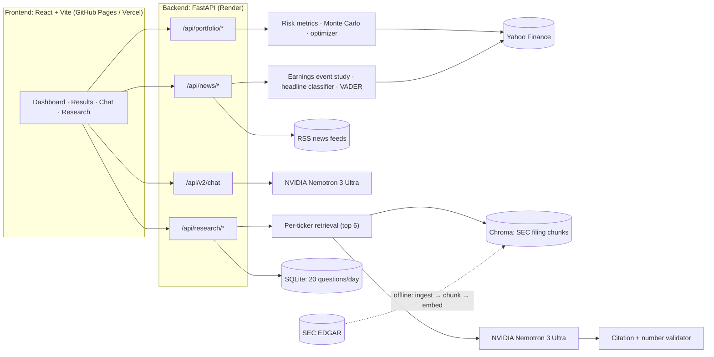
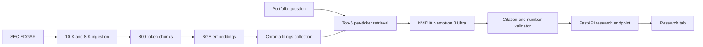

# Arcus — AI-Powered Portfolio Analytics Platform

[](https://github.com/shreyas1504/Arcus/actions/workflows/ci.yml)

**Conversational AI meets institutional-grade risk analytics.** Ask your portfolio anything. Get Sharpe ratios, VaR, Monte Carlo simulations, and stress tests — explained in plain English.

🌐 **Live Demo:** [arcus-insights.com](https://arcus-insights.com)

---

## What It Does

Arcus gives retail investors the same risk analytics that hedge funds use — without the complexity. Pick your stocks, set a date range, and get a full quantitative breakdown with plain-English interpretations.

| Feature | What It Tells You |
|---|---|
| **Health Score (0–100)** | One number summarising portfolio quality. Green (>70) = healthy. |
| **Sharpe / Sortino Ratio** | Risk-adjusted return — are you being rewarded for the risk you're taking? |
| **Beta vs S&P 500** | How much your portfolio amplifies market swings. |
| **Value at Risk (95%)** | Worst expected daily loss on a bad day. |
| **Max Drawdown** | Deepest peak-to-trough loss — the gut-check number. |
| **Monte Carlo Simulation** | 300+ simulated future paths using Geometric Brownian Motion. |
| **Efficient Frontier** | Random portfolios plotted on a risk-return map with your current vs optimal allocation. |
| **Stress Testing** | Estimated losses under 2008 Crisis, COVID Crash, Dot-Com Bust, and custom scenarios. |
| **AI Chat (Arcus AI)** | Ask questions about your portfolio in natural language. |
| **Sector Analysis** | GICS sector breakdown with concentration warnings. |
| **Correlation Heatmap** | Pairwise stock correlations — are your holdings truly diversified? |
| **News Impact** | How your holdings have actually reacted to their last 8 earnings reports. |
| **Arcus Research** | Answers questions about your holdings using only their SEC filings, with a citation on every sentence. |

---

## Product Philosophy

Arcus was built on one observation: retail investors have access to the same raw data as hedge funds, but not the analytical infrastructure to interpret it.

**Key product decisions:**
- **Health Score (0–100) as the primary UX anchor** — Sharpe ratios and VaR percentages are meaningless to most users. A single score reduces cognitive load and gives immediate feedback without requiring financial literacy.
- **AI grounded in live portfolio data, not general knowledge** — Arcus AI is explicitly constrained to only reference data injected from the user's actual portfolio. The system prompt enforces: "Use only the provided portfolio data; do not invent missing values." Hallucinated figures destroy trust in a financial product.
- **MVP scope: 5 core risk metrics before advanced features** — Sharpe, Beta, VaR, Max Drawdown, and Health Score shipped first. Monte Carlo, Efficient Frontier, and Stress Testing came after validating users understood the core output.
- **Conversational interface over raw dashboards** — the AI Chat layer exists because numbers without interpretation don't drive decisions. Users need to ask "is my portfolio too risky?" not just see a Beta of 1.4.

**Success metric:** A retail investor with no finance background can understand their portfolio risk posture and get one actionable recommendation in under 60 seconds.

---

## Tech Stack

### Backend
| Tool | Purpose |
|---|---|
| **FastAPI** | REST API with automatic OpenAPI docs |
| **Python 3.11+** | Core analytics engine |
| **NumPy / Pandas** | Numerical computation and data manipulation |
| **SciPy** | Portfolio optimisation (SLSQP constrained minimiser) |
| **yfinance** | Historical price data from Yahoo Finance |
| **NVIDIA Nemotron 3 Ultra** | Arcus AI chat (grounded in live portfolio context with multi-turn memory) and filing-only answers for Arcus Research, via NVIDIA's API |
| **VADER** | Headline sentiment for News Impact |
| **SEC EDGAR + BeautifulSoup** | 10-K and earnings-release ingestion for Arcus Research |
| **BGE small + Chroma** | Local embeddings (`BAAI/bge-small-en-v1.5`) and the persistent vector index for filings |

### Frontend
| Tool | Purpose |
|---|---|
| **React 18 + TypeScript** | Component-based UI |
| **Vite** | Lightning-fast build tooling |
| **Tailwind CSS** | Utility-first styling with dark theme |
| **Framer Motion** | Smooth animations and transitions |
| **Recharts** | Interactive financial charts |
| **Shadcn/ui** | Accessible component library |

---

## Architecture



Portfolio analytics, News Impact and Arcus AI work from live market data and
the user's portfolio. Arcus Research works from a prebuilt index of SEC filings
and sits behind feature flags (`RESEARCH_ENABLED` on the backend,
`VITE_ENABLE_RESEARCH` on the frontend).

---

## Getting Started

### Prerequisites
- Python 3.11+
- Node.js 18+
- npm

### 1. Clone

```bash
git clone https://github.com/shreyas1504/Arcus.git
cd Arcus
```

### 2. Backend Setup

```bash
pip install -r backend/requirements.txt
uvicorn backend.main:app --reload --port 8000
```

### 3. Frontend Setup

```bash
cd frontend
npm install
npm run dev
```

### 4. Open

- **Frontend:** [http://localhost:8080](http://localhost:8080)
- **API Docs:** [http://localhost:8000/docs](http://localhost:8000/docs)

---

## Testing

Arcus has **340+ automated tests** across the backend and frontend. Every push and pull request to `main` runs both suites in GitHub Actions ([`ci.yml`](.github/workflows/ci.yml)), and the frontend is only built and deployed if they pass.

### Backend — pytest

```bash
pip install -r backend/requirements-dev.txt
pytest backend/tests
```

| File | Covers |
|---|---|
| `test_metrics.py` | Sharpe, Sortino, Beta, VaR, CVaR, max drawdown, annualised return/volatility, Calmar, alpha, information ratio, diversification score, correlation matrix, health score |
| `test_event_study.py` | Headline classification and the earnings event study (abnormal return, volatility change, volume spike, skipped events) |
| `test_cors.py` | Allowed origins and the Vercel preview regex, including lookalike domains |
| `test_research.py` | Research universe, SEC filing selection and section extraction, chunking, citation/number validation, quota, feature flag |
| `test_research_edge_cases.py` | Research request validation, ticker normalization, rate limiting, model failures, repair-then-fallback, number formats, multi-ticker retrieval |

### Frontend — Vitest + Testing Library

```bash
cd frontend
npm test
```

| File | Covers |
|---|---|
| `calculations.test.ts` | Portfolio metrics: weight normalisation, Sharpe, covariance volatility, VaR/CVaR, health score, HHI concentration, edge cases |
| `sandbox.test.ts` | What-if sandbox: metric recalculation, stress scenarios, weight updates, Sharpe recommendations |
| `portfolio-flow.test.ts` | Settings persistence, API request formation, sector derivation, PDF metric consistency, goal alignment |
| `chatbot.test.ts` | Portfolio context sent to the AI, chat launcher flow, chat API behaviour |
| `news-impact.test.tsx` | News Impact panel rendering and formatting |
| `sentiment-badge.test.tsx` | Sentiment pill and badge components |
| `api-base.test.ts` | API base URL resolution |
| `research.test.tsx` | Research tab: supported tickers, citation rendering, error and empty states |

---

## Project Structure

```
Arcus/
├── backend/
│   ├── main.py                 # FastAPI app entry point
│   ├── config.py               # Constants and demo portfolios
│   ├── analytics/
│   │   ├── metrics.py          # All risk calculations + interpretations
│   │   └── event_study.py      # Earnings event study + headline classification
│   ├── data/
│   │   └── fetcher.py          # yfinance data fetching + caching
│   ├── models/
│   │   ├── monte_carlo.py      # GBM simulation engine
│   │   └── optimizer.py        # Sharpe maximisation solver
│   ├── routers/
│   │   ├── portfolio.py        # /api/portfolio/* endpoints
│   │   ├── chat.py             # AI chatbot endpoint
│   │   ├── news.py             # Live market news feed + News Impact
│   │   ├── research.py         # /api/research/* (flag, quota, citations)
│   │   └── adapter.py          # /api/v2/* adapter layer
│   └── tests/                  # pytest suite
├── research/
│   ├── ingest.py               # SEC EDGAR download + section extraction
│   ├── chunk.py                # 800-token chunks, 100-token overlap
│   ├── store.py                # BGE embeddings → Chroma "filings"
│   ├── embedder.py             # ONNX BGE query embeddings (no torch)
│   ├── fetch_assets.py         # Build-time download of the published index
│   ├── qa.py                   # Retrieval, Nemotron, grounding validator
│   └── eval/                   # 30-question benchmark + live edge cases
├── frontend/
│   ├── src/
│   │   ├── pages/              # Index, Onboarding, Dashboard, Results, Chat, Research
│   │   ├── components/         # Reusable UI components + charts
│   │   ├── lib/                # API client, utilities
│   │   └── test/               # Vitest suite
│   ├── vite.config.ts
│   └── package.json
└── .github/
    └── workflows/
        └── ci.yml              # Tests, build, and deploy to GitHub Pages
```

---

## Key API Endpoints

| Method | Endpoint | Description |
|---|---|---|
| `POST` | `/api/portfolio/analyze` | Full portfolio analysis with all metrics |
| `POST` | `/api/portfolio/monte-carlo` | Monte Carlo simulation |
| `POST` | `/api/portfolio/efficient-frontier` | Efficient frontier computation |
| `POST` | `/api/portfolio/stress-test` | Historical stress test scenarios |
| `POST` | `/api/v2/chat` | AI chatbot conversation |
| `GET` | `/api/news/market` | Live RSS market news feed |
| `GET` | `/api/news/sentiment/{ticker}` | VADER sentiment across a ticker's recent headlines |
| `POST` | `/api/news/event-impact` | Earnings event study for a list of tickers |
| `GET` | `/api/research/status` | Whether Arcus Research is enabled and its index is loaded |
| `POST` | `/api/research/ask` | Filing-only answer with citations (`question`, `tickers`, `client_id`) |

---

## News Impact

Headlines tell you what happened. The News Impact panel tells you what it has
historically been worth to your holdings.

**Headline classification.** Every live headline is bucketed into `EARNINGS`,
`POLICY`, `GEOPOLITICAL` or `OTHER` by a literal, whole-word keyword list — no
model, no scoring, and the rules are readable in
`backend/analytics/event_study.py`. Anything that matches nothing is `OTHER`
rather than a guess.

**Earnings event study.** For each ticker, Arcus takes the last 8 reported
earnings dates from Yahoo Finance and measures the market's reaction over the
day **-1 to +3** window. Day 0 is the session that carries the reaction: an
announcement at or after the 16:00 close is measured from the next trading day.

| Measure | How it is computed |
|---|---|
| **Abnormal return** | The ticker's cumulative return across the window minus SPY's over the same window. |
| **Volatility change** | Standard deviation of daily returns over the 5 sessions after the event vs the 20 sessions before. |
| **Volume spike** | Event-day volume divided by the prior 20-session average volume. |

Results are aggregated per ticker and overall as a mean, a median, and the
share of reactions that were positive. Results are cached for 6 hours.

**On missing data.** Any event whose window runs off the end of the available
price history — a report from last week, a recent listing — is skipped, counted,
and reported in the response. Skipped events contribute nothing to the averages,
and a study with no usable events renders an empty state. No figure shown in
this panel is estimated, interpolated or sampled.

---

## Arcus Research

Arcus Research answers questions about a user's indexed holdings using only SEC
filings. The fixed universe contains 21 companies: the first 20 Arcus popular
stocks plus Micron (`MU`); NVIDIA is already included.



### Corpus

For each company, ingestion downloads the latest non-amended 10-K and the two
latest 8-K filings reporting Item 2.02 results. It extracts:

- 10-K Item 1 — Business
- 10-K Item 1A — Risk Factors
- 10-K Item 7 — Management's Discussion and Analysis
- Each 8-K's Exhibit 99.1 earnings release

The expected clean corpus is 63 source filings and 105 logical documents.
Every request to SEC EDGAR must identify the caller with a real name and email.

### Local setup

Serving needs only `requirements-research.txt` (Chroma plus an ONNX copy of the
embedding model). Rebuilding the index also needs torch and sentence-transformers:

```bash
pip install torch --index-url https://download.pytorch.org/whl/cpu
pip install -r backend/requirements-research-index.txt

export SEC_USER_AGENT="Your Name your@email.com"
export NVIDIA_API_KEY="nvapi-..."
export RESEARCH_ENABLED=true
export VITE_ENABLE_RESEARCH=true

python -m research.ingest
python -m research.chunk
python -m research.store
python -m research.eval.run_eval

# with the backend running on :8000
python -m research.eval.edge_cases
```

To serve from the published index instead of rebuilding it, run
`python -m research.fetch_assets`.

`BAAI/bge-small-en-v1.5` creates local normalized embeddings: sentence-transformers
when building the index, and the same model's ONNX export through onnxruntime
when answering queries (identical vectors, no torch on the server). Chroma persists
the `filings` collection under `research/data/chroma` by default. Answer
generation calls NVIDIA's hosted API (`integrate.api.nvidia.com`, free keys from
[build.nvidia.com](https://build.nvidia.com)) with
`nvidia/nemotron-3-ultra-550b-a55b`; override it with `RESEARCH_MODEL`.

The backend rejects unsupported tickers, validates every citation, verifies
that every answer number occurs in a retrieved excerpt, and returns
`Not found in the filings.` when evidence or grounding is insufficient.

### Deployment

Research runs on Render's free plan. The build installs
`requirements-research.txt` and runs `python -m research.fetch_assets`, which
downloads the prebuilt Chroma index and ONNX embedder (125 MB) from the
`research-index-v1` GitHub release and checks its SHA-256. With Research
loaded the backend peaks at about 360 MB, under the plan's 512 MB.

To publish a rebuilt index, pack it with
`python -m research.fetch_assets --pack arcus-research-assets.tar.gz`, upload
it to a new release, and update `ASSET_URL` and `ASSET_SHA256` in
`research/fetch_assets.py`.

The flags are backend `RESEARCH_ENABLED=true` and frontend
`VITE_ENABLE_RESEARCH=true`; without them the tab is hidden and the endpoint
returns 404. `GET /api/research/status` reports `ready: true` once the index
loads. A SQLite counter allows 20 successful questions per anonymous browser
per UTC day; on the free plan's ephemeral disk it resets on each deploy.

### Evaluation

The 30-question benchmark is in `research/eval/questions.jsonl`: 25 answerable
questions with expected source sections and five questions whose answers are
outside the corpus. `research/eval/run_eval.py` writes measured results to
`research/eval/results.md`.

| Metric | Measured | Target |
|---|---:|---:|
| Top-6 retrieval hit rate | **100.0% (25/25)** | ≥80% |
| Answers with no unsupported numbers | **100% (30/30)** | 100% |
| Exact not-found responses | **5/5** | 5/5 |
| Median end-to-end latency | **3.00s** (p95 13.7s) | <4s |
| Answerable questions answered | 25/25 | — |

Measured on the complete 21-company index with
`nvidia/nemotron-3-ultra-550b-a55b` on NVIDIA's API and the ONNX query
embedder (2026-11-10). Number
grounding is enforced by the validator, so the cost of strictness shows up as
answerable questions falling back to "Not found in the filings." Long
risk-factor answers drive the p95 latency.

Known limits: tables may lose visual relationships during HTML-to-text
conversion; unusual SEC heading markup may require extraction fallbacks;
filings are refreshed manually; the browser quota is not account-grade
enforcement; NVIDIA API capacity and backend cold starts can exceed the
four-second latency target. The number check matches values, not units, so
"$20.3 million" would pass against a source saying "$20.3 billion". "Latest"
questions may be answered from the older of the two earnings releases, and
companies that renamed segments (Microsoft in 2026) can get either naming
depending on which filing is retrieved.

---

## Disclaimer

This tool is for educational and demonstration purposes only. It does not constitute financial advice. Always do your own research before making investment decisions.

---

## AI Integration Details

The AI layer (backend/routers/chat.py) is built around three explicit design principles:

**Grounding:** Every conversation turn dynamically injects the user's live portfolio — tickers, weights, prices, and all computed metrics (Sharpe, Sortino, VaR, CVaR, Beta, Max Drawdown, Alpha, Annualized Return, Volatility, Health Score) — into the system prompt. The model only sees what the user's portfolio actually contains.

**Safety / Hallucination Prevention:** The system prompt explicitly instructs the model not to invent missing values, and to clearly state when data is unavailable. This prevents confidently stated incorrect financial figures. On a 41-question grounding test (`backend/evals/grounding_eval.py`, Nemotron 3 Ultra as both assistant and judge, 2026-11-10), replies containing an invented figure fell from 23/41 without the rule to 4/41 with it; the remaining cases were suggested target weights and clearly labelled assumptions. Missing data was acknowledged in 18/18 cases and 0/4 false premises were accepted.

**Multi-Turn Context:** Full conversation history is passed on every request, enabling coherent follow-up questions across a session. Investor risk tolerance and target return are also injected per turn for personalized responses.

---

**Built by [Sai Shreyas Vyamajala](https://github.com/shreyas1504)**
