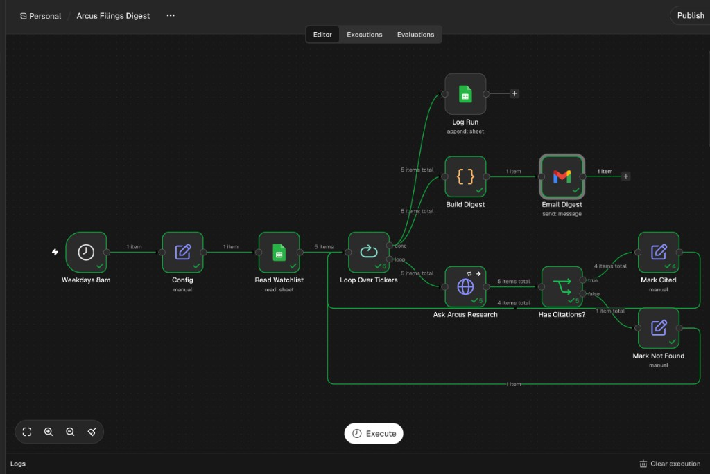
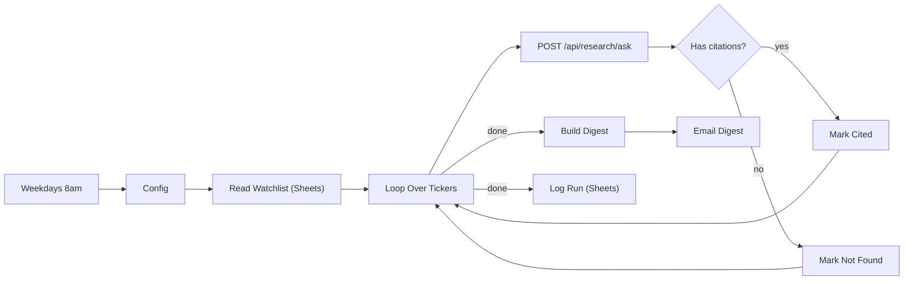

# Arcus Filings Digest (n8n)

Every weekday at 8am (New York time) this workflow asks Arcus Research one
question per watchlist ticker and emails a single digest of cited answers.
Every answer comes only from SEC filings and links to its source; tickers
whose filings do not answer the question are flagged instead of guessed.

<!-- After the first successful run, save the n8n canvas as workflow.png and
uncomment:  -->

## Flow



| Node | What it does |
|---|---|
| Weekdays 8am | Cron `0 8 * * 1-5`, workflow timezone America/New_York |
| Config | Backend URL, default question, digest recipient |
| Read Watchlist | Reads the `watchlist` tab |
| Ask Arcus Research | One request per ticker, 120 s timeout, 3 tries; sends `X-Automation-Key` from a credential |
| Has Citations? | Cited answers go one way; "Not found" and errors go the other |
| Build Digest | One HTML email, flagged tickers first, numbered SEC links per answer |
| Log Run | Appends `date, ticker, status, latency_ms, citations` to the `runs` tab |

Status is `cited`, `not_found` (the filings do not answer the question) or
`error` (for example a ticker outside the Research universe).

## Google Sheet

Create one spreadsheet with two tabs:

- `watchlist` with header `ticker` and, optionally, `question` to override the
  default question for that row:

  | ticker | question |
  |---|---|
  | NVDA | |
  | MU | |
  | AMD | |
  | INTC | What revenue did the company report? |
  | AMAT | |

- `runs` with headers `date, ticker, status, latency_ms, citations`.

Tickers must be in the Research universe (`RESEARCH_TICKER_UNIVERSE` in
`backend/config.py`). TSM is not: it files 20-F and 6-K reports, which the
ingester does not parse, so it would be logged as `error`.

The default question, "What did management say about demand and the outlook
for next quarter?", returned cited answers for NVDA, MU, AMD, INTC and AMAT.
"What did management say about capex and demand?" was found only for INTC
and AMAT; the others do not discuss capex in those terms.

## Setup

1. Set a long random `AUTOMATION_KEY` in the Render service's environment and
   redeploy. Requests carrying the matching `X-Automation-Key` header skip the
   20-questions-per-day limit; without the variable the header is ignored.
2. Run n8n, either locally:

   ```bash
   docker run -it --rm -p 5678:5678 -v n8n_data:/home/node/.n8n n8nio/n8n
   ```

   then open http://localhost:5678, or use an n8n Cloud trial.
3. Workflows -> Import from File -> `filings-digest.json`.
4. Create three credentials and select them on the nodes:
   - Header Auth, named `Arcus automation key`: Name `X-Automation-Key`,
     Value = your `AUTOMATION_KEY` (Ask Arcus Research).
   - Google Sheets OAuth2 (Read Watchlist, Log Run).
   - Gmail OAuth2 (Email Digest).
5. Edit **Config** (backend URL, recipient email) and set your spreadsheet ID
   on Read Watchlist and Log Run.
6. Run it once with Execute Workflow, check the email and the `runs` tab, then
   activate it.

Keep the key in the Header Auth credential rather than typing it into the
HTTP node: n8n leaves credential secrets out of exported workflow files, so
`filings-digest.json` stays safe to commit.

## Verification

The workflow was imported into n8n 2.47 and executed against a local Arcus
backend, with the Sheets and Gmail nodes replaced by stubs. All tickers were
processed, a mixed-case ` nvda ` row was normalized, a per-row question was
used, TSM was logged as `error` ("Unsupported research tickers: TSM"), and
`remaining_today` stayed at 20, confirming the automation key bypassed the
quota.
